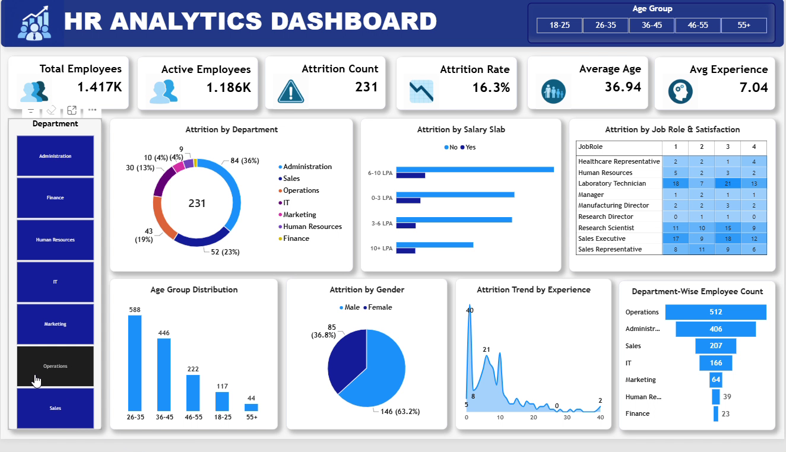
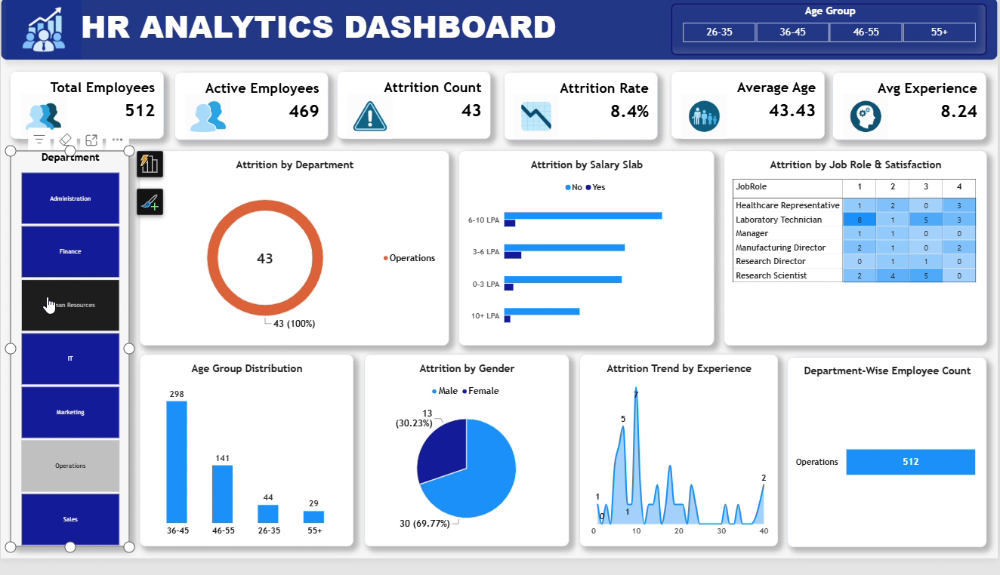

# HR Analytics Dashboard | Power BI

## Project Overview

This project explores employee demographics, workforce composition, and employee attrition using an interactive Microsoft Power BI dashboard. The goal is to make workforce patterns easier to examine and to support data-informed HR discussions.

The analysis uses a dataset containing **1,480 employee records and 37 fields**.

## Dashboard Preview

### Dashboard overview



### Interactive filtering



## Business Questions

The dashboard is designed to explore questions such as:

- What proportion of employees have left the organization?
- How does attrition vary across departments, job roles, age groups, and salary slabs?
- How does attrition differ between employees who work overtime and those who do not?
- How are employees distributed across demographic and experience groups?
- How does attrition vary with employee experience?

## Key Findings

The following findings were calculated from the supplied CSV dataset:

- **1,480** employee records were included.
- **241** employees were recorded as having left.
- The overall attrition rate was **16.28%**.
- The **18–25** age group had the highest attrition rate, at approximately **36.6%**.
- Employees recorded as working overtime had an attrition rate of approximately **31.2%**, compared with **10.4%** for employees not working overtime.
- **Sales Representatives** had the highest attrition rate among the listed job roles, at approximately **40.5%**.
- Human Resources had the highest departmental attrition rate in this dataset, at approximately **26.8%**.

These are descriptive findings and show associations in this dataset; they do not establish that any particular factor causes employees to leave.

## Dashboard Features

- Workforce KPI cards, including total employees, active employees, attrition count, attrition rate, average age, and average experience.
- Attrition analysis by department, salary slab, job role, and gender.
- Age-group and employee-experience analysis.
- Department-wise employee distribution.
- Interactive department and age-group filters.

## Tools

- Microsoft Power BI — dashboard development and interactive data visualization
- CSV — source data

## Repository Structure

```text
HR-Analytics-Power-BI/
├── README.md
├── data/
│   └── HR_Analytics-4.csv
├── dashboard/
│   └── hr_analysis.pbix
└── images/
    ├── hr_dashboard_overview.png
    └── hr_dashboard_interactive.png
```

## How to Explore

1. Download or clone this repository.
2. Open `dashboard/hr_analysis.pbix` using Power BI Desktop.
3. Use the available slicers to filter the dashboard and explore how the visuals respond.
4. The source dataset is available in the `data` folder.

## Data Note

The dataset is included for portfolio demonstration. Before making this repository public, confirm that you have the right to redistribute the source dataset and that it contains no confidential or personally identifiable employee information.

## Limitations

This is a descriptive analysis of the supplied dataset. The patterns should not be interpreted as causal explanations of employee attrition or generalized to other organizations without further validation.

## Author

**Palmer**

[GitHub](https://github.com/)
